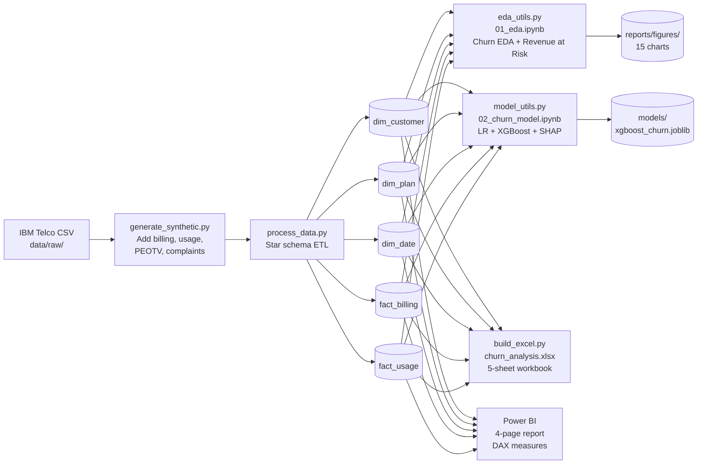
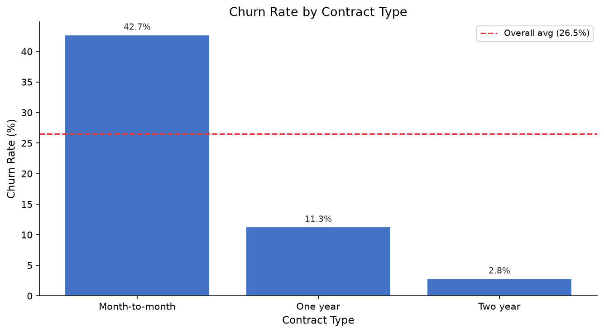
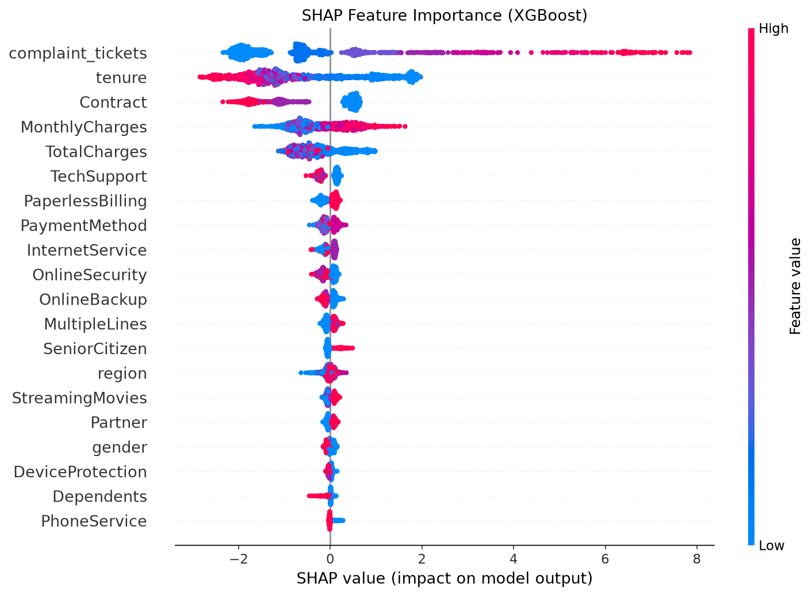
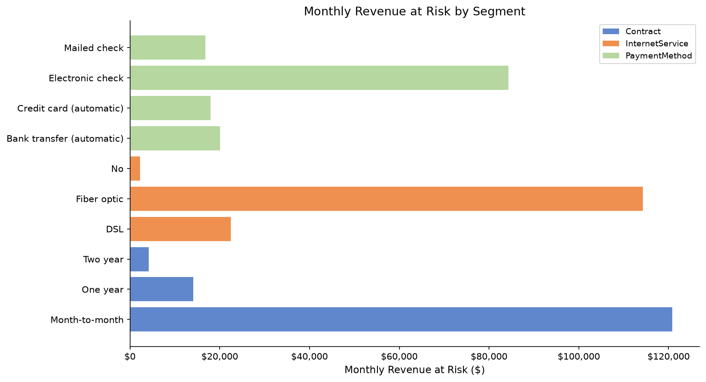

# Telecom Customer Churn & Revenue Analytics

A full-stack data analytics portfolio project simulating a real-world churn and revenue analysis for a telecommunications company. Covers the complete data pipeline from raw data ingestion to machine learning, Excel dashboards, and Power BI reporting.

---

## Problem Statement

Customer churn is one of the costliest problems in telecoms. Acquiring a new customer costs 5–7× more than retaining an existing one. With a **26.5% churn rate** across 7,043 customers and **$139,131 of monthly recurring revenue at risk**, the business needs to:

1. Understand *which* customers are most likely to churn and *why*.
2. Quantify the revenue impact by segment.
3. Build a predictive model to enable proactive retention.
4. Surface insights through self-service dashboards for business users.

---

## Dataset

**Base:** [IBM Telco Customer Churn](https://github.com/IBM/telco-customer-churn-on-icp4d) — 7,043 customers, 21 features including contract type, internet service, tenure, and monthly charges.

**Synthetic enrichment** (see `src/generate_synthetic.py`, seed=42):

| Added feature | Description |
|---|---|
| Monthly billing history | 12–24 months per customer, ±5% charge noise |
| Data usage (GB/month) | Fibre: μ=45 GB · DSL: μ=20 GB · No internet: 0 |
| Call minutes/month | Uniform [50, 600] |
| PEOTV subscription | 20% of internet customers (SLT-PEOTV style bundle) |
| Payment delays | 10% / 5% / 2% probability per month for M2M / 1yr / 2yr contracts |
| Complaint tickets | Poisson(λ): churned customers λ=0.30/mo, retained λ=0.05/mo |

---

## Architecture



---

## Tools & Stack

| Layer | Tools |
|---|---|
| Data processing | Python 3.12 · pandas · numpy |
| Machine learning | scikit-learn · XGBoost · SHAP · imbalanced-learn |
| Visualisation | matplotlib · seaborn |
| Excel automation | openpyxl |
| Notebooks | Jupyter Lab |
| BI reporting | Power BI Desktop (build guide provided) |
| Version control | Git · GitHub |

---

## Key Results

| Metric | Value |
|---|---|
| Dataset size | 7,043 customers |
| Overall churn rate | 26.5% |
| Monthly revenue | $456,117 |
| Monthly revenue at risk | $139,131 (30.5%) |
| XGBoost ROC-AUC | **0.964** |
| XGBoost Recall | **0.896** |
| XGBoost F1 | **0.817** |

---

## Key Business Insights

| # | Segment | Churn Rate | Revenue at Risk | Action |
|---|---|---|---|---|
| 1 | Month-to-month contracts | **42.7%** | $120,847/mo | Loyalty upgrade offer at month 3–6 |
| 2 | Tenure 0–12 months | **47.4%** | $68,954/mo | Structured onboarding programme |
| 3 | Fiber optic customers | **41.9%** | $114,300/mo | Priority complaint resolution + renewal anchoring |
| 4 | Electronic check payment | **45.3%** | $84,289/mo | Auto-pay migration with bill credit |

Full analysis: [`reports/business_insights.md`](reports/business_insights.md)

---

## Project Structure

```
├── data/
│   ├── raw/                    # IBM Telco CSV (not committed — download below)
│   └── processed/              # Star schema tables (CSV)
│       ├── dim_customer.csv
│       ├── dim_plan.csv
│       ├── dim_date.csv
│       ├── fact_billing.csv
│       └── fact_usage.csv
├── notebooks/
│   ├── 01_eda.ipynb            # Exploratory data analysis
│   └── 02_churn_model.ipynb    # ML model + SHAP explanations
├── src/
│   ├── generate_synthetic.py   # Adds synthetic billing/usage/complaints
│   ├── process_data.py         # Builds star schema tables
│   ├── eda_utils.py            # Reusable EDA chart functions
│   ├── model_utils.py          # Reusable ML training & evaluation
│   └── build_excel.py          # Generates Excel workbook
├── excel/
│   ├── churn_analysis.xlsx     # 5-sheet Excel workbook
│   └── EXCEL_GUIDE.md          # Manual Power Query / PivotTable guide
├── powerbi/
│   ├── DAX_measures.md         # 10 DAX measures with explanations
│   └── POWERBI_BUILD_GUIDE.md  # Step-by-step 4-page report build
├── models/
│   ├── xgboost_churn.joblib    # Trained XGBoost model
│   ├── logistic_regression_churn.joblib
│   ├── scaler.joblib
│   └── model_metrics.csv
├── reports/
│   ├── figures/                # 15 saved charts (PNG)
│   └── business_insights.md   # 4 insights with numbers + actions
├── requirements.txt
└── README.md
```

---

## How to Run

### 1. Clone and install dependencies

```bash
git clone https://github.com/emeshika/Telecom-Customer-Churn-Revenue-Analytics.git
cd Telecom-Customer-Churn-Revenue-Analytics
pip install -r requirements.txt
```

### 2. Download the raw dataset

The IBM Telco CSV is excluded from version control (large source file). Download it:

```bash
curl -L "https://raw.githubusercontent.com/IBM/telco-customer-churn-on-icp4d/master/data/Telco-Customer-Churn.csv" \
     -o data/raw/Telco-Customer-Churn.csv
```

Or download manually from [IBM's GitHub](https://github.com/IBM/telco-customer-churn-on-icp4d/blob/master/data/Telco-Customer-Churn.csv) and place it in `data/raw/`.

### 3. Run the data pipeline

```bash
python src/generate_synthetic.py   # enriches data, saves to data/processed/
python src/process_data.py         # builds star schema tables
```

### 4. Run the EDA and model

```bash
python src/eda_utils.py            # saves 8 charts to reports/figures/
python src/model_utils.py          # trains models, saves SHAP plots + model files
```

Or open the notebooks interactively:

```bash
jupyter lab notebooks/
```

### 5. Generate the Excel workbook

```bash
python src/build_excel.py          # creates excel/churn_analysis.xlsx
```

### 6. Build the Power BI report

Follow [`powerbi/POWERBI_BUILD_GUIDE.md`](powerbi/POWERBI_BUILD_GUIDE.md) step by step.  
DAX measures are in [`powerbi/DAX_measures.md`](powerbi/DAX_measures.md).

---

## Screenshots

*Power BI Overview page*
<!--  -->

*Churn rate by contract type*


*SHAP feature importance (XGBoost)*


*Revenue at risk by segment*


---

## Analytical Decisions

| Decision | Rationale |
|---|---|
| Star schema over flat table | Separates slowly-changing dimensions from fast-changing facts; standard in telco BI and required for Power BI time intelligence |
| XGBoost over Logistic Regression | Higher F1 (0.817 vs 0.793) and AUC (0.964 vs 0.951); LR retained as an interpretable baseline |
| Recall as primary metric | Missing a churner (false negative) costs a full customer; a false alarm costs one retention call — asymmetric cost justifies recall focus |
| `scale_pos_weight` over SMOTE | Keeps training distribution real; avoids synthetic sample noise that can hurt precision on real data |
| SHAP over feature importance | Gives directional, per-customer explanations — retention teams need to know *why* a specific customer is flagged, not just global rankings |
